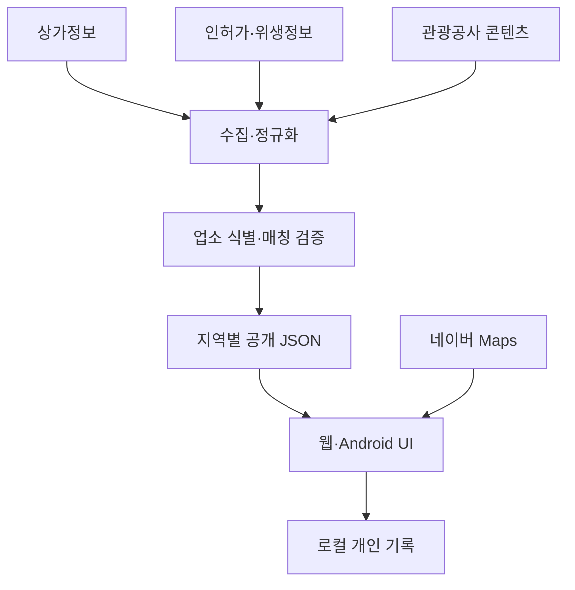

# 맛집한눈 제품 기획서 v0.2

작성일: 2026-10-27 (KST) · 기준: 네이버 지도 + 공공데이터 중심

> 오늘 내 상황에 맞는 한 끼를, 선택 이유와 정보의 근거까지 한눈에.

## 1. 목표와 결정 사항

음식점을 발견한 후 지도·후기·가격·영업정보를 여러 번 오가는 수고를 줄인다. 전국 식당의 기본 목록 위에 공식 확인 정보와 나의 방문 기억을 연결하여 선택을 돕는다. ‘맛집’이라는 이름으로 검증되지 않은 맛 순위나 평점을 만들어 내지 않는다.

| 구분 | 확정 방향 |
|---|---|
| 지도 | **네이버 Maps Dynamic Map**. 웹과 Android WebView에서 공통 사용 |
| 전국 식당 목록 | 소상공인시장진흥공단 상가(상권)정보를 기본 원천으로 사용 |
| 인허가·폐업 확인 | 일반음식점·휴게음식점 인허가 공개자료 및 식품안전나라의 적용 가능한 데이터 |
| 위생 배지 | 식품안전나라 C004의 유효한 식품안심업소(위생등급) 지정 정보 |
| 사진·소개 | 한국관광공사 국문 관광정보(TourAPI)의 음식점 콘텐츠와 출처·이용조건이 확인된 사진 |
| 민간 장소 검색 | 네이버 지역 검색은 추후 선택적 보완. 카카오 장소 API는 출시 필수 조건에서 제외 |
| 배포 | 웹 소스·공개 데이터는 softm/matjiphannun, 서비스는 GitHub Pages |
| Android | softm/matjiphannun.android 비공개 저장소, 공통 웹 UI를 담은 하이브리드 앱 |
| 개인 데이터 | 기본 로컬 저장·JSON 백업/복원. 별도 동의 없는 방문기록 외부 전송 없음 |

**네이버 지도를 사용한다고 네이버의 식당 목록·리뷰·메뉴·별점이 함께 제공되는 것은 아니다.** 지도와 식당 데이터 공급자를 분리한다. 지도 키 발급, 공공 API 활용승인, 데이터 호출 성공, 앱 화면 연동 성공도 각각 별도 완료 조건이다.

## 2. 사용자 경험과 화면

| 화면 | 핵심 행동 | 표시 정보 |
|---|---|---|
| 첫 진입 | 위치 허용 또는 동네 선택 | 위치 조회→데이터 조회→지도 반영 단계별 로딩. 기본 위치를 현위치로 오인시키지 않음 |
| 내 주변 | 현재 화면·반경·음식 종류로 탐색 | 네이버 지도, 거리별 마커, 목록, 사진이 있는 실제 식당 |
| 오늘의 한 끼 | 가까운 곳·먹고 싶은 종류·저장한 곳 중심 선택 | 추천 이유 2~3개. 맛 평가와 상황 적합도를 구분 |
| 식당 상세 | 전화·네이버 길찾기·저장·내 기록 | 주소, 직선거리, 출처, 갱신일, 공식 위생 배지, 확인된 소개·메뉴·영업시간 |
| 나의 맛집 | 저장·방문 메모·개인 평가 | 먹은 메뉴, 재방문 의향, 마지막 방문일. 본인 기록임을 표시 |
| 데이터 현황 | 원천과 품질 확인 | 전체/좌표/매칭/사진/위생 확보율, 수집 성공시각, 오류·누락 |

### 지도 집중모드 공통 규칙

- 초기 진입은 지도 전체 영역과 확장된 하단 패널을 기준으로 구성한다. PC는 지도·목록 병렬, 모바일은 지도 위 하단 시트.
- 모바일 마커 또는 라벨 선택 시 전체지도 집중모드로 진입하고 상세를 연다. 마커·라벨·목록 선택은 같은 식당 ID를 사용한다.
- 목록과 상세 시트는 `compact → expanded → full` 3단계를 지원한다. 드래그 핸들·확장 버튼·키보드 조작을 함께 제공한다.
- 패널 높이 변화 시 네이버 지도 크기를 갱신하고 선택 마커가 가려지지 않도록 시야를 조정한다. 목록 스크롤로 지도 컨테이너 높이가 줄어들지 않아야 한다.
- 추천 TOP5를 구별하되 이름·추천 근거를 보여준다. 확인된 가격이 있을 때만 가격을 표시하며 ‘최저가’는 동일한 메뉴·조건 비교가 가능할 때만 사용한다.
- 화면 전체를 CSS로 회전하는 방식은 사용하지 않는다. ‘가는 길 맛집’은 후속 단계에서 공식 경로 API 검증 후 도입한다.

## 3. 데이터 공급과 이용 범위

| 원천 | 확보 대상 | 한계와 화면 규칙 | 수집 목표 주기 |
|---|---|---|---|
| 상가(상권)정보 | 상가업소번호, 상호, 업종, 주소, 좌표 | 맛·별점·가격·실시간 영업 근거가 아님 | 초기 전량 파일/업종별 페이지 수집, 이후 수정일 기준 일 1회 확인 |
| 인허가 공개자료 | 인허가번호, 업소명·주소, 영업 상태 | 행정상 정상과 ‘지금 영업 중’은 별도 | 원천 게시·변경 주기에 맞춰 확인 |
| 식품안전나라 C004 | 지정등급·기간·취소·영업상태 | 유효기간·취소 여부를 확인한 배지만 표시. 미지정은 낮은 위생을 뜻하지 않음 | 일 1회 변경 확인 목표, 실제 쿼터 확인 후 확정 |
| TourAPI | 음식점 소개, 사진, 제공되는 메뉴·휴무·영업시간 필드 | 등록된 관광 음식점만 보강. 모든 식당의 사진·가격 확보를 보장하지 않음 | 음식점 목록 변경 확인 일 1회, 상세는 변경분을 분산 갱신 |
| 사용자 기록 | 저장·방문·개인 평가·메뉴 메모 | 타인 평점·검증 리뷰로 환산하지 않음 | 사용자 저장 즉시 로컬 반영 |

주기는 **운영 목표**이며 원천의 갱신속도와 같다는 뜻이 아니다. API별 쿼터·호출 제한·활용기간은 승인 화면을 기준으로 관리한다. 수집이 오래되면 기준일을 표시하고 최신 정보인 것처럼 안내하지 않는다.

사진은 저작자·제공기관·원문·공공누리 유형을 보관한다. 변경금지 유형은 자르기·필터·합성 없이 원본 비율로 표시한다. 사진이 없으면 업종 아이콘으로 대체하며 생성 이미지나 다른 지점의 사진을 실제 식당 사진처럼 쓰지 않는다.

## 4. 선택을 돕는 인사이트

| 인사이트 | 필요한 근거 | 데이터 부족 시 |
|---|---|---|
| 가까운 한 끼 TOP5 | 조회 지점과 검증된 식당 좌표 | 위치 미확인 안내, 거리순 미제공 |
| 다시 가고 싶은 곳 | 본인의 재방문 의향·방문 기록 | 사용자 기록을 먼저 안내 |
| 공식 위생정보 있는 곳 | 유효한 지정 정보와 확정된 업소 매칭 | ‘공식 지정정보 미확인’ |
| 동네 음식 종류 분포 | 현재 수집한 업종·지역·중복 제거 결과 | ‘수집된 식당 기준’과 모수 표시 |
| 사진으로 고르기 | 이용조건을 확인한 해당 업소 사진 | 실제 사진 있는 곳만 필터 |
| 예산에 맞는 한 끼 | 출처·확인일이 있는 메뉴와 가격 | 기본 출시에서 숨김, 확인되지 않은 가격 추정 금지 |
| 지금 먹을 수 있는 곳 | 제공된 영업시간·시간대·휴무 정보 | ‘현재 영업 여부 확인 필요’, 전화·외부 지도 연결 |

추천 점수는 **상황 적합도**로만 정의한다. 거리·음식 종류 일치·개인 저장/방문 선호를 구성요소로 표시한다. 위생 지정은 독립된 사실 배지로 제공하고, 사진이 없는 식당을 맛이 낮은 곳으로 취급하지 않는다. 예산·혼밥·아이 동반 같은 조건은 확인된 속성이 있을 때만 강한 필터로 사용하고 업종만으로 단정하지 않는다.

## 5. 운영 아키텍처

- GitHub Actions는 비공개 Secrets를 이용해 배치 수집한다. 원본 응답은 비공개 작업 영역에서 처리하고 공개에 필요한 필드만 발행한다.
- 공개 저장소에는 정제된 식당 JSON·출처·상태 보고서만 저장한다. 대표자·사업자번호·인증키·개인 위치·방문 기록은 공개하지 않는다.
- `data/manifest.json`과 지역별 샤드로 나눠 필요한 지역만 조회한다. 대형 원본 다운로드를 앱 실행마다 반복하지 않는다.
- 마지막 정상 데이터와 원자적 manifest 교체로 API 장애 시에도 기존 목록을 유지한다. 오류를 정상 0건으로 덮어쓰지 않는다.
- 네이버 지도 Client ID는 웹 SDK용 허용 도메인 설정과 함께 사용한다. Client Secret·공공 API 키는 프론트 번들·APK에 포함하지 않는다.
- 주소 검색·역지오코딩은 네이버 공식 Geocoder 서브 모듈로 처리한다. 공개 Client ID와 허용 origin 제한을 사용하며 Secret을 클라이언트에 포함하지 않는다. 네이버 지도 표시와 공공 식당 목록 조회는 독립적으로 동작한다.
- 별도 서버가 필요한 경우 검색·주소 변환 등 요청 처리만 담당한다. 웹·식당 데이터 전체를 다른 배포처에 중복 저장하지 않는다.

## 6. 업소 식별과 정합성

공적 식별자가 같은 인허가 자료는 우선 결합한다. 상가업소번호·인허가번호·관광공사 콘텐츠 ID는 서로 다른 키이므로 각각 유지한다. 정규화한 상호·도로명주소·건물·층/호·전화·좌표로 연결 후보를 만들고, 동일 건물의 지점·입점 식당은 이름 또는 좌표 근접만으로 자동 합치지 않는다. 위생 배지는 확정된 연결에만 부여한다. 애매하면 출처별 자료를 분리하고 매칭 검토 대상으로 둔다.

영업상태 충돌 시 원천과 기준일을 남긴다. 최근 공식 폐업 확인 업소는 일반 추천에서 제외한다. 좌표가 없거나 범위를 벗어나면 지도에서 제외하되 삭제하지 않고 보완 대기 목록으로 관리한다.

## 7. 단계별 개발·검증

| 단계 | 작업 | 완료 기준 |
|---|---|---|
| P0-A | 네이버 Maps 키·도메인·호출 한도 설정 | 전용 앱 등록과 인증정보 확인, 키 없는 샘플 사용 금지 |
| P0-B | 상가정보·TourAPI 활용신청 | 접수번호·승인·사용기간·인증키 확인, 실제 API 호출 성공과 별도 기록 |
| P0-C | 네이버 지도 전환·웹뷰 검증 | 운영 URL과 Android에서 지도·현위치·마커/라벨·시트 크기 조절 확인 |
| P0-D | 전국 기본 식당 수집·지역 샤딩 | 원천 건수·처리 건수·좌표 건수·지역 누락 집계, 재수집 재개 가능 |
| P1-A | 인허가·위생 결합 | C004 발급/승인 및 유효기간·동명이점 매칭 검증 |
| P1-B | 관광공사 사진·소개 연결 | 매칭 근거, 이미지별 출처·이용조건 보존 |
| P1-C | 개인화·인사이트 | 모수·근거·미확인 처리와 로컬 기록 삭제/백업 확인 |
| P2 | 가는 길 맛집·확인된 메뉴 가격·예약 | 별도 데이터·쿼터·서비스 계약과 실기기 검증 후 적용 |

## 8. 성과·수익 모델

핵심 지표는 식당 조회→상세→길찾기 전환, 다시 저장하는 비율, 7일/30일 재방문이다. 데이터 지표는 지역별 수집 완전성·좌표 확보율·사진 연결률·유효 위생배지 비율·폐업 오류 신고율로 관리한다. 분모와 기준일을 함께 기록한다.

수익화는 하단 접힘형 AdFit과 Android AdMob을 후속 적용한다. 협찬은 광고로 분리하고 추천 적합도에 가산하지 않는다. 지도를 가리거나 상세를 닫을 때마다 전면광고를 노출하는 흐름은 피한다.

## 9. 현재 상태 — 2026-10-27

| 항목 | 확인 상태 |
|---|---|
| 운영 웹 | PC·모바일에서 네이버 지도·주소 검색·마커 선택·사진·위생정보·시트 크기 조절 확인 |
| Android | 동일 웹 화면을 패키징한 0.2.0 APK CI 빌드 통과. 실기기 지도 인증·위치 권한 확인 전 |
| 네이버 지도 전용 앱 | `matjiphannun` 생성·Client ID/Secret 발급 확인 |
| 지도 허용 Web origin | `https://softm.github.io`, `https://appassets.androidplatform.net` 등록 |
| 네이버 지도 사용량 제한 | Dynamic Map 일 5,000 / 월 100,000, 지오코딩·역지오코딩 각 일 1,000 / 월 10,000. 초과 허용 안 함 |
| 상가정보·TourAPI | 개발계정 2건 신청·자동승인 완료, 일반 인증키 적용 확인. 이용기간 2026-10-27~2028-10-27 |
| 식품안전나라 | 로그인·기존 인증키 승인 상태 확인. C004 약관 동의·이용신청 제출 완료, 신청일 2026-10-27과 인증키 적용 목록 추가 확인 |
| 데이터 수집·화면 연동 | 상가정보·관광공사·C004 실제 응답 확보, 수집·정규화·압축 샤딩 구현. 공개 목록 850,129곳, 사진 9,444곳, 유효 위생정보 1,003곳. 원천 기준일 2026-06-30과 수집일 구분 |
| 자동 갱신 | 워크플로 구현. Secrets 2건과 활성화 변수 등록 전 |

## 10. 공식 자료

- [소상공인 상가(상권)정보 API](https://www.data.go.kr/data/15012005/openapi.do)
- [한국관광공사 국문 관광정보 서비스](https://www.data.go.kr/data/15101578/openapi.do)
- [식품안전나라 C004](https://www.foodsafetykorea.go.kr/api/openApiInfo.do?menu_grp=MENU_GRP31&menu_no=661&show_cnt=10&start_idx=1&svc_no=C004)
- [식품안전나라 API 이용방법](https://www.foodsafetykorea.go.kr/api/howToUseApi.do)
- [네이버 Maps Application 가이드](https://guide.ncloud-docs.com/docs/application-maps-app-vpc/)
- [네이버 Maps 콘솔](https://console.ncloud.com/maps/application)

현행 화면과 공식 문서를 확인한 설계이며, 제공사 정책·쿼터는 발급·출시 시 재확인한다. 최신 신청 상태는 [API 발급 현황](API_ISSUANCE.md)을 따른다.
